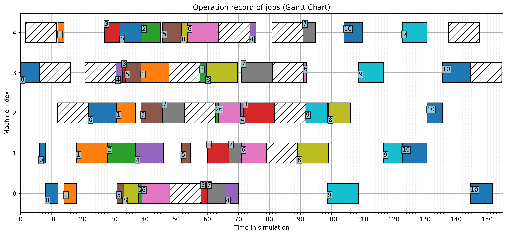

# DRLforDynamicScheduling

## Overview

This repository contains the source code for the research project titled **"Multi-agent Imitational, Chronological, and Asynchronous Reinforcement Learning Framework for Production Scheduling."**

The project tackles the **Dynamic Job Shop Scheduling Problem (DJSSP)** under real-world shopfloor uncertainties (Poisson job arrivals, non-preemptive machine breakdowns, and stochastic processing times). It includes:
1. **Discrete-Event Simulator (`src/simulator/`)**: Built on `SimPy`, modeling machines, jobs, queues, strategic idleness, and dynamic disruptions.
2. **Centralized Production Scheduler & Heuristics (`src/scheduler/`)**: Online rescheduling via Mixed-Integer Linear Programming (**Gurobi**) and Constraint Programming (**Google OR-Tools CP-SAT**), alongside classical dispatching rules (`FIFO`, `LIFO`, `Slack`, `CR`, `SPT`, `LWKR`).
3. **Deep Multi-Agent Reinforcement Learning (`src/DRL/`)**: Parameter-sharing Double Deep Q-Network (DDQN) agents for decentralized real-time job sequencing.

> **For AI Coding Agents & Contributors**: Please read [`AGENTS.md`](AGENTS.md) for a comprehensive architectural deep-dive, module-by-module guide, mathematical formulation, and simulation lifecycle invariants.

## Requirements

- **Python**: `>= 3.13, < 3.14` (pinned in `.python-version` and `pyproject.toml`)
- **Project manager**: [`uv`](https://docs.astral.sh/uv/) (`brew install uv`)
- **Dependencies**: Declared in `pyproject.toml`, locked in `uv.lock`. `requirements.txt` is a generated pip-compatible export for users not using `uv`.
- **Optional extras**: `gurobi` (Gurobi MILP backend), `plot` (Gantt chart via matplotlib), `analysis` (pandas/scikit-learn/h5py/PyYAML).
- **Solver Note**: The default scheduler is Google **OR-Tools CP-SAT** (`-sqc ORTools`), which needs no license. **Gurobi** (`-sqc GurobiOptimizer`) is optional and requires a valid license. Both optimization backends are imported lazily, so heuristic-only runs work even if neither package is installed.

## Project Structure

```text
.
├── AGENTS.md                       # Architectural & domain guide for AI agents and developers
├── WORKNOTE.md                     # Handoff log: latest work done + changes not yet implemented
├── doc/                            # Documentation, figures, and research proposals
├── logs/                           # Timestamped simulation logs and generated Gantt charts
├── math_modeling/                  # Mathematical optimization formulation (JSP_model.md)
├── src/                            # Source code package
│   ├── DRL/                        # Deep Multi-Agent Reinforcement Learning (DDQN, state/reward/padding)
│   │   ├── brain_sequencing.py     # Parameter-sharing DDQN agent and neural network architectures
│   │   ├── brain_routing.py        # Placeholder for routing MARL agent
│   │   ├── pytorch_padding.py      # Variable-length sequence padding/packing reference for RNN/LSTM
│   │   └── reward_function.py      # Reward function definitions
│   ├── scheduler/                  # Centralized production schedulers and heuristic dispatching rules
│   │   ├── scheduler.py            # CentralScheduler, GurobiOptimizer (MILP), and ORTools (CP-SAT)
│   │   ├── sequencing_rule.py      # Pure heuristic rules (FIFO, LIFO, Slack, CR, SPT, LWKR)
│   │   └── ORToolsJSP.py           # Standalone OR-Tools CP-SAT JSSP example
│   ├── simulator/                  # SimPy discrete-event simulator
│   │   ├── simulator.py            # Simulator, SimulatorMultiThread, and Shopfloor classes
│   │   ├── event.py                # Narrator (job arrivals, breakdowns, post-sim KPIs) and Recorder
│   │   ├── machine.py              # Machine entity, queue management, and strategic idleness
│   │   ├── job.py                  # Job entity, routing trajectory, and operation records
│   │   └── exc.py                  # Custom simulator exception classes
│   ├── analysis/                   # Offline replay / state reconstruction from the SQLite trace
│   │   ├── state_reconstruction.py # ShopfloorStateReconstructor (full per-machine state at any time)
│   │   └── __main__.py             # CLI: uv run python -m src.analysis --run_id 1 --time 77.0
│   └── utilities.py                # Logger configuration, SQLite persistence, and Gantt chart plotting
├── main.py                         # Main CLI entry point to run simulations
├── pyproject.toml                  # Project metadata and dependency groups (uv)
├── uv.lock                         # Reproducible dependency lockfile (commit this)
├── .python-version                 # Python 3.13
├── test.py                         # Convenience runner for the unittest suite
├── Makefile                        # `make sync` / `make test`
├── tests/                          # Stdlib-unittest verification suite (isolated temp DB/logs)
├── README.md                       # Project documentation
└── requirements.txt                # Generated pip-compatible export of uv.lock
```

## Quick Start & Usage

Create the pinned Python 3.13 environment and install all optional extras:

```bash
brew install uv          # once
uv sync --all-extras     # creates .venv from uv.lock
```

`uv sync` (without `--all-extras`) installs the core simulator, schedulers, and DRL dependencies; add `--extra plot` for Gantt charts, `--extra gurobi` for the Gurobi backend, or `--extra analysis` for pandas/scikit-learn/h5py/PyYAML.

Run `main.py` for a demonstration (defaults to 5 machines, nominal span of 100 time units, 60% expected utilization, and the `ORTools` CP-SAT scheduler):

```bash
uv run python main.py
```

Use Google **OR-Tools** explicitly, a heuristic rule (`FIFO`, `LIFO`, `Slack`, `CR`, `SPT`, `LWKR`), or Gurobi (license required):

```bash
uv run python main.py -sqc ORTools
uv run python main.py -sqc CR -seed 42
uv run python main.py -sqc GurobiOptimizer   # requires a valid Gurobi license
```

Run two independent episodes in parallel worker processes (each gets a distinct derived seed and its own `runs` row):

```bash
uv run python main.py -sqc FIFO -mt -tn 2 -seed 42
```

Stochastic occupation times (`-pt_v` / `-rnd_mttr`) with an optimization scheduler normally ask for confirmation. In CI or piped runs, pass `-y/--force` to proceed non-interactively; without it the run aborts with a clear error instead of hanging or silently skipping the prompt.

### Command-Line Arguments

| Flag | Long Option | Default | Description |
| :--- | :--- | :--- | :--- |
| `-m_no` | `--m_no` | `5` | Number of machines (workstations) in the shopfloor |
| `-seed` | `--seed` | `0` | Random seed (`0` generates a random seed automatically) |
| `-span` | `--span` | `100` | Nominal simulation horizon for generating job arrivals |
| `-utl` | `--E_utliz` | `0.6` | Expected system utilization rate (controls Poisson arrival rate) |
| `-dt` | `--due_tightness` | `2.0` | Due date tightness factor (upper multiplier on total processing time) |
| `-pt_r` | `--pt_range` | `1 10` | Range of nominal operation processing times `[min_pt, max_pt]` |
| `-pt_v` | `--processing_time_variability` | `False` | Enable stochastic processing times |
| `-pt_cv` | `--pt_cv` | `0.1` | Coefficient of variation (CV) when `-pt_v` is enabled |
| `-mbkd` | `--machine_breakdown` | `True` | Flag to disable machine breakdowns when passed |
| `-mtbf` | `--MTBF` | `50.0` | Mean Time Between Failures (MTBF) |
| `-rnd_mtbf` | `--random_MTBF` | `True` | Sample time between failures from an Exponential distribution (enabled by default) |
| `--no-random_MTBF` | — | — | Use a deterministic MTBF instead of sampling |
| `-mttr` | `--MTTR` | `10.0` | Mean Time To Repair (MTTR) |
| `-rnd_mttr` | `--random_MTTR` | `False` | Sample repair time from Uniform `[0.5 * MTTR, 1.5 * MTTR]` |
| `-db` | `--db_path` | `logs/simulation.db` | Path to persistent SQLite database storing all simulation runs |
| `-draw` | `--draw_gantt` | `5` | Seconds to display interactive Gantt chart (`0` disables pop-up; disabled if `span >= 250`) |
| `-save_gantt` | `--save_gantt` | `True` | Flag to disable saving `gantt_chart.png` to the run's log directory |
| `-ns` | `--no_stream` | `False` | Suppress console (`INFO`) log output |
| `-y` | `--force` | `False` | Proceed without interactive confirmation (needed for stochastic occupation times + optimization scheduler when stdin is not a TTY) |
| `-mt` | `--multi_thread` | `False` | Run independent episodes in parallel worker processes |
| `-tn` | `--thread_no` | `1` | Number of parallel workers when `-mt` is enabled |
| `-sqc` | `--sqc_method` | `ORTools` | Scheduler/rule: `GurobiOptimizer`, `ORTools`, `FIFO`, `LIFO`, `Slack`, `CR`, `SPT`, `LWKR` |

### Solver Behavior

- Both optimization backends optimize a **true lexicographic hierarchy**: (1) cumulative tardiness, (2) makespan, (3) sum of operation start times. The CP-SAT backend uses two staged solves rather than fixed weights, so one unit of tardiness can never be traded for a large makespan reduction.
- If a solver returns `INFEASIBLE` / `UNKNOWN` / no incumbent, the scheduler logs a warning and falls back to the deterministic **passive schedule** instead of reading undefined variable values. The fallback is recorded in `schedule_cycles.solver_status` with a `_PASSIVE_FALLBACK` suffix.
- `Slack` is the true minimum-slack rule: `due - now - total_remaining_processing_time` (it is no longer an alias for EDD).
- Solver backends and `matplotlib` are imported lazily, so heuristic runs and the offline analysis CLI do not require a GUI or an optimization package.

### Logging & SQLite Database (`logs/simulation.db`)

Every simulation episode automatically persists its full structured data into a single SQLite database (`logs/simulation.db`) across 7 relational tables:
- `runs`: Episode configuration, parameters, aggregate KPIs (mean/max tardiness, flowtime, utilization, wall/solver time), plus `status` (`running` / `completed` / `failed`) and an `error` traceback for failed episodes
- `jobs`: Per-job creation time, due date, completion time, status, tardiness, flowtime, and routing/PT JSON arrays
- `operations`: Per-operation execution records (`m_idx`, `decision_type`, `arrival_t`, `begin_t`, `end_t`, `wait_t`, `expected_pt`, `actual_pt`, `scheduled_begin_t`) and a `completed` flag (0 when the episode ended while the operation was still in progress)
- `decisions`: Exact decision-replay snapshot — the authoritative queue at decision time (`queue_json`), the chosen position (`chosen_pos`), per-candidate features keyed by job index (`candidates_json`), plus reserved DRL columns (`state_json`, `action`, `reward`, `next_state_json`, `episode_done`)
- `breakdowns`: Machine breakdown intervals, expected repair times, and production delays
- `schedule_cycles`: Centralized rescheduling snapshots, solver status, solve time, and machine/job schedules
- `sim_events`: Chronological discrete-event trace (`JOB_CREATED`, `JOB_IN`, `OP_START`, `OP_OUT`, `JOB_END`, `IDL_ON`, `STR_IDL_ON`, `BKD_START`, `RESCHEDULE`, etc.)

To keep memory usage bounded during long simulation runs, the dominant `sim_events` table is streamed to disk in batches of 10,000 rows (`Recorder.FLUSH_EVENTS_THRESHOLD`), while the smaller tables are flushed once at the end of each episode.

### Reproducing a Sequencing Decision

Every `decisions` row is a complete, unambiguous snapshot of one decision. To rebuild the scenario:

```sql
SELECT sim_t, m_idx, decision_type, queue_json, chosen_pos, candidates_json
FROM decisions
WHERE run_id = :run_id
ORDER BY sim_t;
```

- `queue_json` is the ordered list of `j_idx` exactly as the machine saw it (`[job_index1, job_index2, ...]`).
- `chosen_pos` indexes into `queue_json`; the chosen job is `queue_json[chosen_pos]` (= `j_idx`).
- `candidates_json` is an object keyed by `j_idx` (string), e.g. `{"10": {"arrival_t": ..., "wait_t": ..., "due_t": ..., "ttd": ..., "slack": ..., "current_pt": ..., "remaining_work": ..., "num_remaining_ops": ..., "critical_ratio": ...}}`. Queue order is authoritative in `queue_json`; rule scores/picks can be derived on demand from these features.

### Reconstructing the Full Shopfloor State (Offline)

For offline RL training, imitation learning, or counterfactual analysis, `src/analysis/state_reconstruction.py` replays the recorded trace and returns the **complete shopfloor condition at any time** — every machine's status, current job, ordered waiting queue, breakdown interval, and next scheduled job, plus every in-system job's remaining route/work.

```python
from src.analysis import ShopfloorStateReconstructor

recon = ShopfloorStateReconstructor(run_id=1)          # defaults to logs/simulation.db and the latest run

state = recon.snapshot(t=77.0)                         # arbitrary time
state = recon.snapshot_at_decision(decision_id=42)     # exact pre-decision state
for state in recon.iter_snapshots():                   # one state per recorded decision
    ...
```

Or from the command line:

```bash
uv run python -m src.analysis --run_id 1 --time 77.0
uv run python -m src.analysis --run_id 1 --decision_id 42
```

Each snapshot is a JSON-serializable dict:

- `machines`: per machine `status` (`idle`, `processing`, `strategic_idle`, `down`), `current_job`, ordered `queue` (arrival order, with candidate features), `breakdown` (expected vs. actual remaining repair), `next_job_in_schedule`, and `release_T` / `hidden_release_T`.
- `jobs`: every in-system job's `status`, `current_machine`, `op_seq`, `due_t`, `wait_t`, `completed_ops`, `remaining_machines`, `remaining_expected_pt`, `remaining_actual_pt`, `tardiness_so_far`, and `flowtime_so_far`.
- `summary`: aggregate counts (jobs in system, processing machines, machines down, waiting jobs, completed/created jobs).
- `decisions`: the recorded decision(s) at exactly `t`; `snapshot_at_decision` also sets `target_decision`.

At a recorded decision time, the deciding machine's queue is taken verbatim from `decisions.queue_json` (authoritative), while all other machines are reconstructed from `operations`, `breakdowns`, `schedule_cycles`, and `sim_events`.

Two entry points cover the two cases:

- `snapshot(t, tie="post")` is a **pure timeline** reconstruction at continuous time `t`. `tie="post"` (the default) treats a job starting exactly at `t` as already processing; `tie="pre"` treats it as still queued.
- `snapshot_at_decision(decision_id)` (and `iter_snapshots()`) reproduce the **exact pre-decision** state. Because several machines can make a decision at the same timestamp, operations that start at exactly `t` are classified by decision order (`decision_id`): a machine whose decision preceded this one is already processing, while one whose decision follows it is still queuing. This resolves the same-timestamp ambiguity that a pure time query cannot.

> **Expected vs. actual:** as in the simulator, `release_T`, `remaining_expected_pt`, and `breakdown.expected_remaining` are what a scheduler observes; `hidden_release_T`, `remaining_actual_pt`, and `breakdown.actual_remaining` are the simulator's ground truth under stochastic processing times/repairs.


In addition, the 3 most recent timestamped text log folders (`logs/<timestamp>/sim.log` and `gantt_chart.png`) are retained for quick inspection.

## Verification / Test Suite

The `tests/` suite uses only the standard library `unittest` (no pytest dependency). Every test runs in a temporary directory and sets `SIM_LOG_ROOT`, so it never modifies `logs/simulation.db` or the project's retained log history.

```bash
# Canonical command (run from the repository root)
uv run python -m unittest discover -s tests -t . -v

# Convenience wrappers
uv run python test.py
make test
```

Coverage includes:

- project-wide syntax compilation, core-module importability, and required-artifact checks;
- all dispatching heuristics (`FIFO`, `LIFO`, `SPT`, `LWKR`, `CR`, true minimum `Slack`);
- CP-SAT lexicographic behavior, `SCALE=10` decimal precision, and `INFEASIBLE`/`UNKNOWN` status guards;
- full FIFO and OR-Tools episodes: job/operation counts, one visit per machine, decision `queue_json[chosen_pos] == j_idx`, candidate-key integrity, foreign-key checks, and scheduled-vs-actual start alignment;
- same-seed reproducibility and streaming-flush event preservation;
- solver fallback, solver-exception run failure, non-interactive `-pt_v` guard, and multi-process isolation;
- SQLite schema migration, `runs.status`/`runs.error` lifecycle, and `operations.completed`;
- offline state reconstruction at every recorded decision and arbitrary times;
- CLI defaults, validation, and entry-point subprocess smoke tests.

Run this suite after any simulator, scheduler, database, or reconstruction change.

### Example Simulation Output (Gantt Chart)



